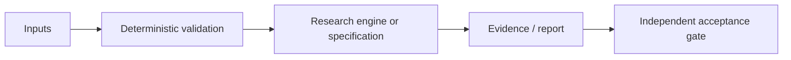

# Agentic AI Economy: научно-техническое досье V5

**Дата ревизии:** 24.10.2026. **Доказательный статус:** SIMULATION. **Репозиторий:** [Shtenco/synergy_agentic_ai_economy](https://github.com/Shtenco/synergy_agentic_ai_economy).

> Документационная оценка фактически обнаруженных файлов main. Не является отчётом о свежем запуске CI, независимом benchmark, готовности производства или научным доказательством результата.

## Исследовательская проблема и проектная цель

Закрытая агентная экономика, DQN-контроллеры и бухгалтерский учёт HardNAV.

## Математическое ядро

\[H_t=A^{external}_t-L^{external}_t,\quad \Delta H_{OOS}=H_{end}-H_{freeze}.\]

Математическая запись отделяет модель от операционно подтверждённого результата. Любые заявленные преимущества должны быть перепроверены на сопоставимых baseline и зафиксированных входных данных.

## Архитектурная карта

Это концептуальный поток: стрелки не обозначают уже развернутую связь с другими сервисами.

## Артефакты исходного дерева

- [`agent_economy/engine.py`](../agent_economy/engine.py)
- [`tests/test_closed_agent_economy.py`](../tests/test_closed_agent_economy.py)
- [`reports/closed_multimarket_hardnav_v4/seed77_10000_train_3000_oos.json`](../reports/closed_multimarket_hardnav_v4/seed77_10000_train_3000_oos.json)

## Критерии приемки и фальсификация

HardNAV не равен внутреннему GDP; верифицировать 10k TRAIN / 3k OOS без reset, корректность gas, source timestamps и отрицательные контроли.

Обязательные поля для подтверждённого результата: commit SHA, environment, invocation, dataset manifest, raw measurements, baseline, uncertainty, adversarial/negative controls и точная область действия утверждения.

## Ограничения и угрозы

Наличие historical replay и сохранённого JSON не гарантирует независимого воспроизведения, а modeled bridge flow не является realized external fee.

Нельзя превращать архитектурную идею, гипотезу, simulated return либо workflow definition в статус DEPLOYED или GREEN без наблюдаемого и проверяемого evidence.

## Следующая итерация

1. Привязать каждый claim к конкретному source/тесту/артефакту.
2. Описать один negative control и минимальный воспроизводимый acceptance-gate.
3. Зафиксировать честный maturity level, а не расширять рекламные формулировки.
4. Сохранять прежние README, историю и исследовательские исходники.

**Эталоны оформления:** [REVERSE-EXP](https://github.com/Shtenco/dlp_solver), [SYNERGY SYSTEM](https://github.com/Shtenco/synergy_system).
